<div align="center">


<br>

[](https://github.com/4anti/claude-better-usage-mod/actions/workflows/test.yml)
[](https://github.com/4anti/claude-better-usage-mod/releases)
[](https://claude.com/claude-code)
[](#install)
[](#languages)
[](LICENSE)

[Install](#install) &nbsp;·&nbsp; [Features](#features) &nbsp;·&nbsp; [Colour](#colour-that-means-something) &nbsp;·&nbsp; [How it works](#how-it-works) &nbsp;·&nbsp; [Usage](#usage) &nbsp;·&nbsp; [Settings](#settings) &nbsp;·&nbsp; [Privacy](#privacy)


</div>


## See it in the app

A live band above the Claude Code prompt. It shows your **5 Hour** and **Weekly** limits with a forecast to the next reset, alerts before you run out, what each chat used, and how full the context window is. Compact in one click, or let it compact for you.

<p align="center">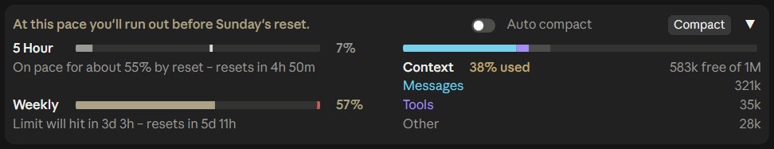</p>

Collapsed, it is one row with the time left until each limit resets. Every chat shares the collapsed or expanded state.

<p align="center">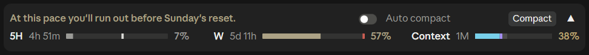</p>

> [!NOTE]
> The band reads your limits as soon as a session opens, so they are there before the first reply. The context refreshes every 3 seconds and your plan about every 2 minutes. It costs no tokens and does not count toward your limits. The 5 Hour and Weekly limits are your whole Claude account's, Claude chat and Cowork included.


## Features

<p align="center">
  
  
  
  
  
  
</p>

<details>
<summary><b>Plan limits with a forecast</b></summary>

- **% used** of the 5 Hour and Weekly limits, matching the app's own *Plan usage limits* panel.
- **A forecast to the reset**: *On pace for about 55% by reset*, or *Limit will hit in 3d 3h*. The tick on each bar marks where you will be when the window resets.
- **A headline** for the window that needs attention: *On track*, *At this pace you'll run out before Sunday's reset*, or *Limit reached*.
- **A learned pace.** The forecast starts from how far your past windows usually got. For the first 15% of a window it uses only that, so an early burst does not raise a false alarm. Then it shifts smoothly to your actual pace.

</details>

<details>
<summary><b>Alerts</b></summary>

- A notification when a limit reaches **90%** (or your own %), and again when it is **reached**.
- When a 5 Hour window you were warned about **resets**: *5 Hour limit reset: your full allowance is back.*
- Each alert is sent once per window, however many chats are open.
- In a terminal it is a system notification. The desktop app does not pass notifications from mods to the system, so there it is a message in the app.

</details>

<details open>
<summary><b>Usage history, by chat</b></summary>

`/quota-history` opens a pane with how far each window got: the running one first, then the last 10 five-hour windows and the last 8 weeks, with your average and how often you hit the limit. Windows are recorded as they end, so the list fills up as you use Claude. New in 0.5:

- **Each bar is split by the chats that used it**, each chat in its own colour. A chat is named by the first prompt you typed in it, because the app gives chats no title.
- **Other / not recorded** is the use no chat here recorded: claude.ai, another device, or anything before 0.5. In the bar it is the grey part.
- **5 Hour windows sit under day headings** (*Today*, *Yesterday*, then the date), each row with its start and end time.
- **Click a row** to unfold the chats behind it, with each one's share.
- Per-chat records start with 0.5, so older windows keep a single bar. Shares are approximate when chats run at the same time: the limits are the account's, so a reply's share includes whatever else used them meanwhile.

</details>

<details>
<summary><b>What this chat used</b></summary>

Under the 5 Hour bar: *This chat used 3% – last reply 0.5%*. It is measured from the start to the end of each reply, and starts over when the 5 Hour window resets.

</details>

<details>
<summary><b>Context window</b></summary>

- The % used and the space free, as `/context` counts it.
- A breakdown into **Messages**, **Tools** and **Other**, calibrated against the exact count every 2 minutes.

</details>

<details>
<summary><b>Compact and Auto compact</b></summary>

- **Compact** runs `/compact` in one click.
- **Auto compact** compacts at your % (30% by default, 15 to 99), only between replies, never during one.
- Click anywhere on the switch, or on its name, to turn it on or off.
- Each chat keeps its own setting. A new chat starts with the last setting you chose.
- If a chat is already past your % when Auto compact turns on, it asks first: **Now** or **After my next compact**.

</details>


## Colour that means something


Everything is Claude's own grey until usage matters. Then it shifts smoothly, never in sudden steps.

| | Grey | Yellow | Red |
| --- | --- | --- | --- |
| **5 Hour and Weekly** | up to 50% | 75% | 95% and over |
| **Context** | up to 25% | 50% | 80% and over |

Bars and their % follow what you have actually used. The **forecast tick** carries the warning on its own: light grey on track, yellow when you are heading past the limit, red when far past it. All of these %s can be changed in [Settings](#settings).


## How it works


Two sources feed the band. The usage service is asked about every 2 minutes, once for all your open chats. Each reply carries its own limits, read live. They are merged **window by window**, so a newer reading wins and a reply that carries only one window never wipes out the other. Every open chat shows the same figures.


## Install

Needs **Claude Code 2.1.287 or later**, signed in with a **Pro or Max** plan. One install covers both the desktop app and the terminal.

**Desktop app.** In the **Code** tab, send this as a message, allow the `claude plugin` commands if asked, then quit and reopen the app:

```text
Install the usage-quota plugin from the GitHub marketplace 4anti/claude-better-usage-mod
```

**Terminal.** Inside `claude`, run these one at a time:

```text
/plugin marketplace add 4anti/claude-better-usage-mod
```

```text
/plugin install usage-quota@4anti-mods
```

```text
/reload-plugins
```

> [!IMPORTANT]
> **Have the original version installed?** Remove it first, or two bands will draw:
>
> ```bash
> claude plugin marketplace remove claude-code-usage-quota-mod
> ```
>
> Saved settings are kept per marketplace, so Auto compact settings and the learned pace start fresh here.

<details>
<summary><b>Update, uninstall, or install from your own shell</b></summary>

Install:

```bash
claude plugin marketplace add 4anti/claude-better-usage-mod
claude plugin install usage-quota@4anti-mods
```

Update, then restart Claude Code:

```bash
claude plugin marketplace update 4anti-mods
claude plugin update usage-quota@4anti-mods
```

Uninstall, then restart Claude Code:

```bash
claude plugin marketplace remove 4anti-mods
```

</details>


## Usage


| Action | How |
| --- | --- |
| Turn the band off or on | `/quota` (while it is off, the status line shows *5H 7% · Weekly 57% · Context 38%*) |
| See past windows | `/quota-history` (or `/quota history`) |
| See which chats used a window | click its row in the history pane |
| Change settings, language included | `/quota-settings` (or `/quota settings`) |
| Expand or collapse | the **▼ / ▲** button |
| Compact now | the **Compact** button |
| Auto compact | the switch, then type a % (it sets on Enter, a click elsewhere, or a 2-second pause) |
| Hide or show it in the terminal | Claude Code's own `[-]`, or **ctrl+x ctrl+a** |

In the desktop app, the band appears once a session has started. The *Welcome back* screen has no session yet, so no mod can draw there.


## Settings

`/quota-settings` opens a pane with every setting as a picker, in the desktop app and the terminal alike. A change applies at once. In a terminal, `/config` lists the same settings under the plugin's own rows. Values out of range fall back to the default. Since 0.5 the pane also works in the desktop app. The app loads a second copy of the mod beside the installed one, and the pane used to change the wrong copy's setting. It now sets the setting in every copy.

| Setting | Default | What it does |
| --- | --- | --- |
| Language | Same as the app | The band's language (see [Languages](#languages)) |
| Alerts | on | Notify at the alert %, at the limit, and when a warned 5 Hour window resets |
| Alert at % | 90 | The % of a limit that raises the first alert (50 to 100) |
| Show what this chat used | on | The *This chat used* line under the 5 Hour bar |
| Usage in the status line | on | The one-line summary while the band is off |
| Auto compact default % | 30 | Where Auto compact starts when you turn it on (15 to 99) |
| Limit colours | `50 75 95` | Grey up to the first %, yellow at the second, red at the third |
| Context colours | `25 50 80` | The same, for the context |


## Languages

The band, its alerts, the history and settings panes, and its messages speak **16 languages**, with times and days in each language's own form (*16:40*, *Pazar*, *日曜日*):

<p align="center">
English · Türkçe · Deutsch · Français · Español · Português · Italiano · Nederlands<br>
Polski · Русский · Українська · 日本語 · 한국어 · 简体中文 · 繁體中文 · Bahasa Indonesia
</p>

By default the band follows the desktop app's language, then your system's (`LC_ALL`, `LANG`), then English. Pick one in `/quota-settings` to override it. Right-to-left scripts are left out for now, because terminals draw them unreliably.

Adding a language is one file in `hooks/i18n/`. Copy `en.ts`, translate each line and keep every `{placeholder}`. The type checker lists any key you missed, and a test checks the placeholders. Corrections from native speakers are welcome.


## Privacy

Everything runs on your machine with the same access Claude Code has. The mod **never sees your credentials** and sends nothing anywhere except the one request below.

| | What it does |
| --- | --- |
| **Network** | About every 2 minutes, one request to `https://api.anthropic.com/api/oauth/usage` through your existing Claude login. Claude Code attaches the credential; the mod never sees it. This is the only host it contacts. |
| **Your session** | Reads the context size and the limits each reply carries. To name a chat in the history, it reads the first prompt you typed in that chat. It never sends what you or Claude write. |
| **Commands** | Runs `/compact` when you press **Compact** or Auto compact reaches your %. Adds `/quota`, `/quota-history` and `/quota-settings`. |
| **Notifications** | Your limits' alerts, through Claude Code's own notification channel (the one your `preferredNotifChannel` setting picks). |
| **Stored on your machine** | In Claude Code's plugin store: the last readings, your learned pace, which alerts were sent, the history of past windows (peaks and reset times only), and each chat's share of them under its name (the first prompt, cut to 48 characters). |
| **Programs** | Only to match a desktop app that follows the system theme: `reg query` for `AppsUseLightTheme` on Windows, `defaults read -g AppleInterfaceStyle` on macOS. |
| **Files** | Reads the desktop app's `config.json` for its theme and language settings, and nothing else. |
| **Settings** | `/quota-settings` changes the plugin's own settings, the ones `/config` lists, and no others. |


## Development

Clone the repo, then run its tests, or load it into a session from the folder:

```bash
claude plugin test ./claude-better-usage-mod
```

```bash
claude --plugin-dir ./claude-better-usage-mod
```

| File | Role |
| --- | --- |
| `hooks/register.tsx` | Every hook and engine call: refreshing, the usage service, alerts, Auto compact, what each chat used, state |
| `hooks/band.tsx` | The band's layout, from plain values |
| `hooks/switch-hit.tsx` | The click area over the Auto compact switch on the desktop |
| `hooks/history.tsx` | The history pane's layout: bars split by chat, day headings, rows that unfold |
| `hooks/forecast.ts` | The pace forecast and the headline |
| `hooks/limits.ts` | Reading the usage service's answer, learning your usual pace, the history list, each chat's share and name |
| `hooks/alerts.ts` | When to alert, once per window |
| `hooks/settings.ts` | Reading and checking the settings |
| `hooks/settings-pane.tsx` | The settings pane's layout |
| `hooks/i18n/` | The 16 languages, one file each, and how the band picks one |
| `hooks/colors.ts` | The palettes, the chat colours, and the grey to yellow to red ramp |
| `tests/` | UI tests on both surfaces (`band.test.tsx`, `features.test.tsx`) and unit tests (`logic.test.ts`) |

The engine allows `$` and state atoms only in the hooks module, so everything else is plain, testable code. Every push runs the tests on GitHub Actions. Issues and pull requests are welcome.


## Credits

A fork of [claude-code-usage-quota-mod](https://github.com/anantraghunath/claude-code-usage-quota-mod) by Anant Raghunath. That project was inspired by [I'm liking the new mods feature](https://www.reddit.com/r/ClaudeCode/comments/1wwjman/im_liking_the_new_mods_feature/) on r/ClaudeCode, with thanks to [u/itsxzy](https://www.reddit.com/user/itsxzy/) for the original prompt.

## License

[MIT](LICENSE)

<div align="center">
<br>
<sub>Not affiliated with Anthropic. Made by <a href="https://github.com/4anti">4anti</a>. If it saves you from a surprise limit, a star on GitHub helps others find it.</sub>
</div>
